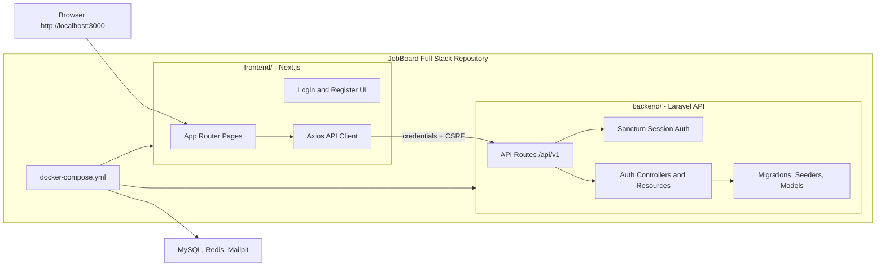

# JobBoard Full Stack

Full-stack job board project with a Laravel API backend and a Next.js frontend in one repository.

## Project Structure

```text
backend/   Laravel API, Sanctum auth, migrations, seeders, tests
frontend/  Next.js app, dashboard pages, auth UI, API client
```



## Local Docker Setup

From the project root:

```bash
docker compose up -d
docker compose exec laravel-api php artisan key:generate
docker compose exec laravel-api php artisan migrate:fresh --seed
```

Services:

| Service | URL / Port |
| --- | --- |
| Frontend | `http://localhost:3000` |
| Laravel API | `http://localhost:8000` |
| MySQL | `localhost:3306` |
| Redis | `localhost:6379` |
| Mailpit UI | `http://localhost:8025` |

The frontend container talks to the backend through Docker as `http://laravel-api:80`. Browser requests use the public API at `http://localhost:8000`.

## Backend

The Laravel app lives in `backend/`.

```bash
cd backend
composer install
cp .env.example .env
php artisan key:generate
php artisan migrate:fresh --seed
php artisan test --compact
```

API routes are prefixed with:

```text
/api/v1
```

See `backend/README.md` for the backend API details.

## Frontend

The Next.js app lives in `frontend/`.

```bash
cd frontend
npm install
npm run dev
```

See `frontend/README.md` for frontend-specific notes.
