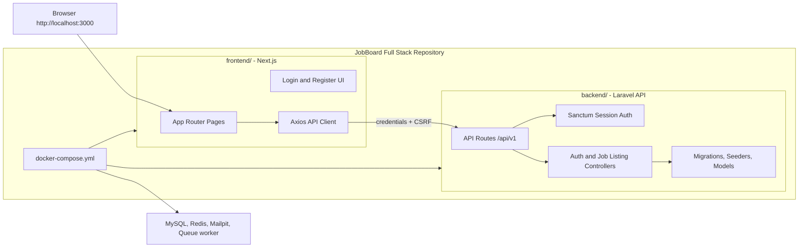

# JobBoard Full Stack

Full-stack job board project with a Laravel API backend and a Next.js frontend in one repository.

## Project Structure

```text
backend/   Laravel API, Sanctum auth, migrations, seeders, tests
frontend/  Next.js app, dashboard pages, auth UI, API client
```

```text
jobboard-fullstack/
├── backend/
│   ├── app/
│   │   ├── Application/
│   │   │   ├── Admin/
│   │   │   ├── Auth/
│   │   │   ├── Interviews/
│   │   │   ├── JobListings/
│   │   │   └── JobApplications/
│   │   ├── Domain/
│   │   │   ├── Admin/
│   │   │   ├── Auth/
│   │   │   ├── Interviews/
│   │   │   ├── JobListings/
│   │   │   └── JobApplications/
│   │   ├── Http/
│   │   ├── Infrastructure/
│   │   ├── Models/
│   │   ├── Notifications/
│   │   └── Support/
│   ├── bootstrap/
│   ├── config/
│   ├── database/
│   │   ├── factories/
│   │   ├── migrations/
│   │   └── seeders/
│   ├── routes/
│   ├── tests/
│   ├── composer.json
│   └── README.md
├── frontend/
│   ├── public/
│   │   └── UI/
│   ├── src/
│   │   ├── app/
│   │   │   ├── (auth)/
│   │   │   └── (dashboard)/
│   │   ├── features/
│   │   │   ├── auth/
│   │   │   ├── jobs/
│   │   │   ├── employer/
│   │   │   ├── applications/
│   │   │   ├── interviews/
│   │   │   ├── admin/
│   │   │   └── notifications/
│   │   ├── infrastructure/
│   │   └── proxy.ts
│   ├── next.config.ts
│   ├── package.json
│   └── README.md
├── docker-compose.yml
├── AGENTS.md
└── README.md
```



## Local Docker Setup

From the project root:

```bash
docker compose up -d
docker compose exec laravel-api php artisan key:generate
docker compose exec laravel-api php artisan migrate:fresh --seed
```

Services:

| Service | URL / Port |
| --- | --- |
| Frontend | `http://localhost:3000` |
| Laravel API | `http://localhost:8000` |
| Queue worker | Background process; no host port |
| MySQL | `localhost:3306` |
| Redis | `localhost:6379` |
| Mailpit UI | `http://localhost:8025` |

Run backend tests without exposing the development MySQL database to `RefreshDatabase`:

```bash
docker compose --profile test run --rm backend-test
```

The frontend container talks to the backend through Docker as `http://laravel-api:80`. Browser requests use the public API at `http://localhost:8000`.

Run the isolated Playwright interview workflow without changing development MySQL data:

```bash
bash scripts/test-e2e.sh
```

The E2E profile uses dedicated Laravel, Next.js, SQLite-volume, and Playwright services. It verifies job bookmarking, saved-only filtering, application submission, candidate application guard, native confirmation dialogs, shortlisting, interview scheduling, conflict feedback, candidate confirmation, role-aware route guards, live account profile updates, and mobile-width rendering with no retries.

## Continuous Integration

`.github/workflows/ci.yml` defines four read-only quality gates:

- workflow validation with actionlint;
- Laravel formatting, clean-architecture boundaries, and the complete Pest suite;
- generated OpenAPI type drift, frontend dependency audit, lint, typecheck, Vitest suite, and production build;
- the isolated Docker/Playwright interview journey after the backend and frontend jobs pass.

Failed browser runs retain their Playwright report, trace, screenshot, and video artifacts for seven days. The same commands can be exercised locally with the backend test profile, the frontend npm scripts, and `bash scripts/test-e2e.sh`.

## Backend

The Laravel app lives in `backend/`.

```bash
cd backend
composer install
cp .env.example .env
php artisan key:generate
php artisan migrate:fresh --seed
php artisan test --compact
```

API routes are prefixed with:

```text
/api/v1
```

See `backend/README.md` for the backend API details.

The backend uses strict inward dependencies for authentication, job listings, applications, interviews, and admin analytics: HTTP controllers call application use cases, use cases depend on contracts and domain entities, and Laravel/Eloquent, private-file, and queued-notification implementations are injected by the service container.

## Frontend

The Next.js app lives in `frontend/`.

```bash
cd frontend
npm install
npm run dev
```

See `frontend/README.md` for frontend-specific notes.

The frontend mirrors that structure per feature with `domain`, `application`, `infrastructure`, `composition`, and `presentation` layers. Authentication, public job browsing, employer job management, candidate application history/withdrawal, applicant review, interview scheduling, admin analytics and user management, and in-app notifications all use generated-contract-aware Laravel adapters.
