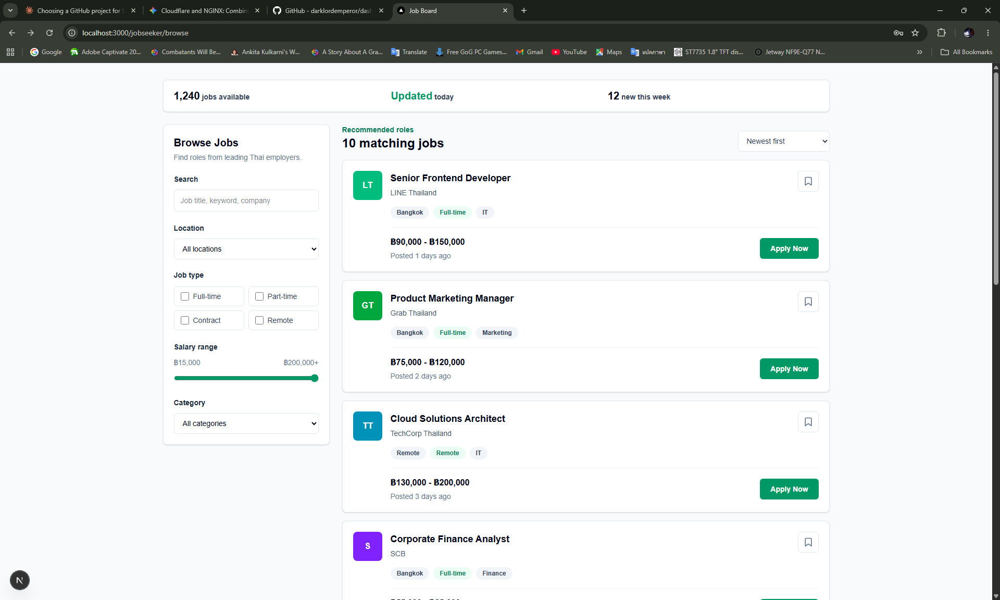
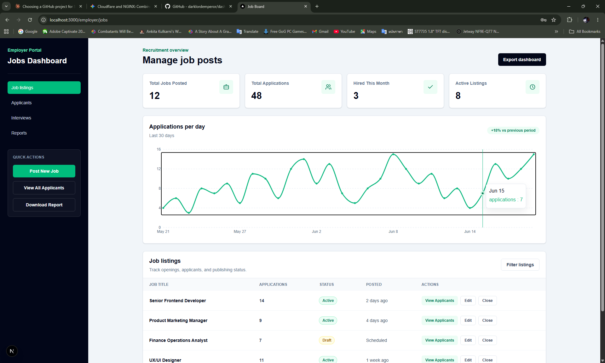
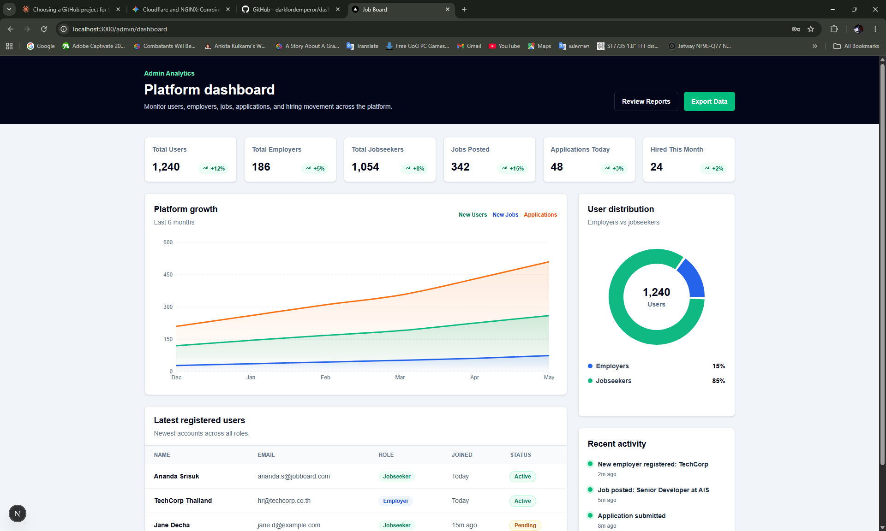

# Job Board Frontend

Next.js frontend for a Job Board application backed by a Laravel 13 REST API. The app uses Laravel Sanctum SPA authentication with cookie-based sessions, not JWT tokens.

## Tech Stack

- Next.js App Router with TypeScript
- React 19
- Tailwind CSS
- Axios behind repository implementations
- Zustand for auth state
- React Hook Form and Zod for forms
- Vitest for framework-independent unit tests
- Recharts for dashboard visualizations
- Docker Compose for local full-stack development

> Note: this repository currently uses `next@16.4.3`. Next's bundled docs mark `middleware.ts` as deprecated in favor of `proxy.ts`, so route protection is implemented in `src/proxy.ts`.

## Backend

The frontend expects the Laravel API project at:

```text
..\backend
```

Default host API URL:

```text
http://localhost:8000
```

Browser requests are sent through Next.js rewrites, so frontend code calls relative URLs such as `/api/v1/auth/login` and `/sanctum/csrf-cookie`. In Docker, Next.js proxies those requests to `http://laravel-api:80`. Outside Docker, it falls back to `http://localhost:8000`.

Required Laravel endpoints:

- `GET /sanctum/csrf-cookie`
- `POST /api/v1/auth/login`
- `POST /api/v1/auth/logout`
- `GET /api/v1/auth/me`
- `PATCH /api/v1/auth/profile`
- `GET /api/v1/job-listings`
- `GET /api/v1/job-listings/{id}`
- `GET /api/v1/jobseeker/saved-jobs`
- `POST /api/v1/jobseeker/saved-jobs/{jobListing}`
- `DELETE /api/v1/jobseeker/saved-jobs/{jobListing}`
- `GET /api/v1/employer/job-listings`
- `GET /api/v1/employer/job-listings/{id}`
- `POST /api/v1/employer/job-listings`
- `PUT /api/v1/employer/job-listings/{id}`
- `POST /api/v1/employer/job-listings/{id}/publish`
- `POST /api/v1/employer/job-listings/{id}/close`
- `POST /api/v1/job-listings/{id}/applications`
- `GET /api/v1/jobseeker/applications`
- `PATCH /api/v1/jobseeker/applications/{id}/withdraw`
- `GET /api/v1/employer/job-listings/{id}/applications`
- `PATCH /api/v1/employer/applications/{id}/status`
- `GET /api/v1/job-applications/{id}/resume`
- `POST /api/v1/employer/applications/{id}/interviews`
- `GET /api/v1/employer/interviews`
- `PATCH /api/v1/employer/interviews/{id}/reschedule`
- `PATCH /api/v1/employer/interviews/{id}/cancel`
- `PATCH /api/v1/employer/interviews/{id}/complete`
- `GET /api/v1/jobseeker/interviews`
- `PATCH /api/v1/jobseeker/interviews/{id}/confirm`
- `GET /api/v1/admin/dashboard`
- `GET /api/v1/admin/users`
- `PATCH /api/v1/admin/users/{id}`
- `GET /api/v1/notifications`
- `PATCH /api/v1/notifications/{id}/read`
- `POST /api/v1/notifications/read-all`

## Auth Flow

Login follows the Sanctum SPA sequence:

1. `GET /sanctum/csrf-cookie`
2. `POST /api/v1/auth/login`
3. Map the returned transport DTO to the `User` domain entity
4. Save the authenticated user in the presentation store
5. Redirect users by role:
   - `admin` -> `/admin/dashboard`
   - `employer` -> `/employer/jobs`
   - `jobseeker` -> `/jobseeker/browse`

On a browser reload, the `GetCurrentUser` use case calls `GET /api/v1/auth/me` to restore the session-backed user.

Protected routes are guarded in `src/proxy.ts` by checking for the Laravel session cookie, `job_board_session`. Unauthenticated requests to `/admin/*`, `/dashboard/*`, `/employer/*`, or `/jobseeker/*` are redirected to `/login?next=...`.

Next.js rewrites are configured in `next.config.ts`:

- `/api/:path*` -> `${NEXT_INTERNAL_API_URL || NEXT_PUBLIC_API_URL || "http://localhost:8000"}/api/:path*`
- `/sanctum/:path*` -> `${NEXT_INTERNAL_API_URL || NEXT_PUBLIC_API_URL || "http://localhost:8000"}/sanctum/:path*`

Axios is configured in `src/infrastructure/http/apiClient.ts` with:

- `baseURL: "/"`
- `withCredentials: true`
- `withXSRFToken: true`
- `X-Requested-With: XMLHttpRequest`

Laravel-specific payload mapping and error conversion live in `features/auth/infrastructure/http/LaravelAuthRepository.ts`.

## Generated API Types

The Laravel OpenAPI document at `../backend/resources/openapi.json` generates the transport declarations in `src/infrastructure/http/generated/openapi.ts`:

```bash
npm run generate:api-types
```

The generated file is committed but must not be edited manually. Laravel HTTP repositories consume its request, query, response, and error types, then map transport DTOs into feature-owned domain entities. Domain and application layers do not import generated or Axios types.

CI regenerates the file and fails when it differs from the committed output, preventing backend contract changes from leaving stale frontend types.

## Environment

Create a local env file from the example:

```powershell
copy .env.example .env.local
```

Current example values:

```env
NEXT_PUBLIC_API_URL=
NEXT_INTERNAL_API_URL=
NEXT_TELEMETRY_DISABLED=1
```

For Docker, `.env.docker` is already included:

```env
NEXT_PUBLIC_API_URL=
NEXT_INTERNAL_API_URL=http://laravel-api:80
NEXT_TELEMETRY_DISABLED=1
WATCHPACK_POLLING=true
CHOKIDAR_USEPOLLING=true
```

`NEXT_PUBLIC_API_URL` is intentionally blank in local env files because Axios uses same-origin relative URLs through Next rewrites. `NEXT_INTERNAL_API_URL` is used by Docker to reach Laravel through the Compose network; if both values are empty, rewrites target `http://localhost:8000`.

## Local Development

Install dependencies:

```powershell
npm install
```

Run the frontend:

```powershell
npm run dev
```

Open:

```text
http://localhost:3000
```

The root route redirects to `/login`.

## Current Pages

- `/login`: Sanctum login form with role-aware post-login redirect.
- `/register`: validated employer/jobseeker registration using the clean auth flow.
- `/jobseeker/browse`: live Laravel-backed job browsing with debounced keyword search, filters, sorting, server-backed `Saved only` toggle (`savedOnly=true`), loading/error/empty states, bookmarks, and pagination.
- `/jobseeker/browse/[id]`: published job detail, candidate application guard (`Application on file` status banner when already applied), and validated cover-letter/optional PDF resume application flow.
- `/jobseeker/applications`: filterable application history with debounced keyword search (`search`), lifecycle counts, private resume download, pagination, and native `<dialog>` confirmation before withdrawal.
- `/jobseeker/interviews`: candidate interview schedule with clickable status summary counts, timezone-aware slot details, attendance confirmation, and `.ics` calendar invite download.
- `/employer/jobs`: live owner-scoped listing dashboard with status counts, debounced keyword search (`search`), applicant/shortlisted summary badges, a keyboard-scrollable table region with sticky headers, pagination, and publish/close actions guarded by `<ConfirmActionDialog>`.
- `/employer/jobs/new`: validated draft creation form.
- `/employer/jobs/[id]/edit`: owner-scoped edit form for open listings.
- `/employer/jobs/[id]/applicants`: owner-scoped applicant pipeline with keyword search (`search`), status filters, counts, private resume download, and controlled status transitions.
- `/employer/interviews`: employer interview schedule with clickable status summary counts, `.ics` calendar invite download, rescheduling, native `<dialog>` cancellation confirmation, and completion actions.
- `/admin/dashboard`: admin analytics dashboard with platform stats, CSV report export, Recharts growth area chart, user distribution pie chart, searchable/paginated platform user directory (`GET /api/v1/admin/users`) with role mutation and account suspension/reactivation actions (`PATCH /api/v1/admin/users/{id}`) protected by `<ConfirmActionDialog>`, and recent activity feed.

All routes under `(dashboard)` share `src/app/(dashboard)/layout.tsx`, `DashboardSessionHeader`, and `DashboardRoleGuard`, which hydrate the authenticated user via Zustand (`useAuthStore` -> `GetCurrentUser`), enforce role-scoped route access, open the `<AccountSettingsDialog>` modal (`PATCH /api/v1/auth/profile`), host the `<NotificationCenterDropdown>` database notification center with unread count badge and mark-all-read action, render role-scoped workspace navigation links, and execute session sign-out via `LogoutUser`.

The admin dashboard chart components are loaded client-side with `next/dynamic({ ssr: false })` because Recharts needs browser layout dimensions for responsive charts.

## UI Preview

Reference dashboard screenshots are stored in `public/UI/`. The employer screenshot predates the live job-management workflow; the running page is the source of truth until screenshots are refreshed.

### Jobseeker Browse



### Employer Jobs



### Admin Dashboard



## Docker Development

Docker Compose is owned by the project root at `..\docker-compose.yml`.
It runs:

- `laravel-api`: PHP 8.4-FPM + Nginx on port `8000`
- `queue-worker`: Laravel Redis queue worker for application lifecycle notifications
- `nextjs-app`: Node 20 on port `3000`
- `mysql`: MySQL 8.0 with persistent volume
- `redis`: Redis 7 for cache and queues
- `mailpit`: email testing, UI on port `8025`

Run the full stack:

```powershell
cd ..
docker compose up --build
```

The development container keeps Linux-compatible dependencies in an isolated
`/app/node_modules` volume. On startup, `docker/dev-start.sh` compares the
current `package-lock.json` hash and runs `npm ci` only when that lockfile has
changed, preventing stale packages after dependency updates.

Useful URLs:

- Frontend: `http://localhost:3000`
- Laravel API: `http://localhost:8000`
- Mailpit: `http://localhost:8025`

Both Laravel and Next.js source folders are bind-mounted for hot reload in development.

## Project Structure

```text
src/
  app/
    (auth)/
      login/page.tsx
      register/page.tsx
    (dashboard)/
      layout.tsx
      admin/dashboard/page.tsx
      employer/interviews/page.tsx
      employer/jobs/page.tsx
      employer/jobs/new/page.tsx
      employer/jobs/[id]/edit/page.tsx
      employer/jobs/[id]/applicants/page.tsx
      jobseeker/browse/page.tsx
      jobseeker/browse/[id]/page.tsx
      jobseeker/applications/page.tsx
      jobseeker/interviews/page.tsx
    layout.tsx
    page.tsx
  features/
    auth/
      domain/
      application/
      infrastructure/
      composition/
      presentation/
        components/
        hooks/
        schemas/
        store/
    jobs/
    employer/
    applications/
    interviews/
    admin/
    notifications/
  infrastructure/http/apiClient.ts
  infrastructure/http/generated/openapi.ts
  proxy.ts
```

## Clean Architecture Flow

Each feature uses the same inward dependency direction:

```text
App Router page / Zustand store
  -> application use case
    -> repository interface
      <- Axios or in-memory repository implementation
    -> domain entity
```

The `composition/` folder is the only place that constructs a repository implementation and injects it into use cases. Authentication, public job browsing, employer job management, job applications, interviews, and admin analytics use Laravel HTTP repositories. The admin adapter maps generated OpenAPI DTOs into feature-owned domain entities before the page formats them for display.

ESLint prevents Domain and Application files from importing React, Next.js, Zustand, Axios, presentation, or infrastructure code.

## Important Files

- `src/features/auth/domain/navigation/roleNavigation.ts`: pure domain rules for role redirects, workspace navigation items, and active route matching
- `src/features/auth/application/use-cases/`: framework-independent auth operations
- `src/features/auth/application/ports/AuthRepository.ts`: auth repository contract
- `src/features/auth/infrastructure/http/LaravelAuthRepository.ts`: Laravel API adapter
- `src/features/auth/composition/authDependencies.ts`: auth composition root
- `src/features/auth/presentation/store/authStore.ts`: Zustand presentation state
- `src/features/auth/presentation/components/DashboardSessionHeader.tsx`: shared dashboard session header, role navigation, and sign-out trigger
- `src/features/jobs/application/use-cases/SearchJobs.ts`: framework-independent job search operation
- `src/features/jobs/infrastructure/http/LaravelJobRepository.ts`: Laravel job-listing adapter
- `src/features/jobs/composition/jobDependencies.ts`: job-listing composition root
- `src/features/employer/application/use-cases/`: framework-independent employer job operations
- `src/features/employer/infrastructure/http/LaravelEmployerJobRepository.ts`: Sanctum-aware employer API adapter
- `src/features/employer/presentation/components/EmployerJobForm.tsx`: shared validated create/edit form
- `src/features/applications/application/use-cases/`: submission, candidate history/withdrawal, resume access, employer review, and status-transition operations
- `src/features/applications/infrastructure/http/LaravelJobApplicationRepository.ts`: application API adapter
- `src/features/applications/presentation/components/JobApplicationForm.tsx`: validated cover-letter form
- `src/features/interviews/domain/calendar/interviewCalendarInvite.ts`: pure RFC 5545 iCalendar (`.ics`) builder for interview invites
- `src/features/admin/application/use-cases/GetAdminDashboard.ts`: framework-independent analytics query
- `src/features/admin/infrastructure/http/LaravelAdminDashboardRepository.ts`: admin-only Laravel analytics adapter
- `src/features/admin/composition/adminDependencies.ts`: admin analytics composition root
- `src/infrastructure/http/apiClient.ts`: shared Axios transport
- `src/proxy.ts`: cookie-based protected route guard for admin, employer, and jobseeker pages
- `src/app/(auth)/login/page.tsx`: login form and role redirect mapping
- `src/app/(dashboard)/layout.tsx`: shared layout wrapping all protected dashboard routes with the session header
- `src/app/(dashboard)/jobseeker/browse/page.tsx`: jobseeker browsing UI
- `src/app/(dashboard)/jobseeker/applications/page.tsx`: candidate application history and withdrawal UI
- `src/app/(dashboard)/jobseeker/interviews/page.tsx`: candidate interview schedule and confirmation UI
- `src/app/(dashboard)/employer/jobs/page.tsx`: live employer listing dashboard and lifecycle actions
- `src/app/(dashboard)/employer/jobs/[id]/applicants/page.tsx`: employer applicant pipeline
- `src/app/(dashboard)/employer/interviews/page.tsx`: employer interview coordination UI
- `src/app/(dashboard)/admin/dashboard/page.tsx`: admin analytics dashboard with Recharts area and pie charts

## API Contract

The Laravel repository adapter expects this API wrapper:

```ts
{
  success: boolean;
  data: T;
  message: string;
  errors: Record<string, string[]> | null;
}
```

## Scripts

```powershell
npm run dev
npm run build
npm run generate:api-types
npm run start
npm run lint
npm run test
```

Use `npm.cmd` on Windows PowerShell if the `.ps1` shim is blocked:

```powershell
npm.cmd run lint
npm.cmd run build
```

## Verification

Run the isolated browser workflow from the repository root:

```bash
bash scripts/test-e2e.sh
```

The Playwright test covers candidate application, employer shortlisting and scheduling, overlap rejection, candidate confirmation, and a 390×844 responsive overflow assertion. The script starts only the E2E-specific Laravel, Next.js, and Playwright services. Laravel uses a dedicated SQLite Docker volume, so development MySQL and ports `3000`/`8000` are not reset. Failures retain HTML, screenshot, video, and trace artifacts under `frontend/playwright-report/` and `frontend/test-results/`.

Playwright and its Docker image are pinned to `1.64.1`; keep those versions aligned when upgrading.

Before pushing changes:

```powershell
npm run lint
npm run test
npm run build
cd ..
docker compose config --quiet
```

Latest verified commands:

```powershell
npm.cmd run lint
npm.cmd run test
npm.cmd run build
```

Vitest is pinned to the patched 4.1 line while retaining compatibility with the project's Node 20 Docker image. Dependency audit findings in existing production packages are reported separately and are not force-fixed because those upgrades require compatibility validation.

## AI Disclosure

This project was scaffolded and iterated with AI assistance. The generated code was reviewed through linting and production build checks.
